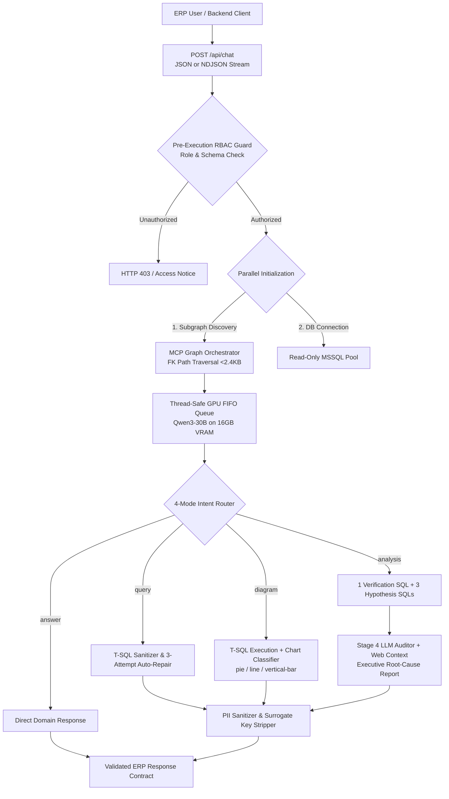

# GreenXERP AI — Autonomous Enterprise NLQ, BI Charting & Multi-Hypothesis Analytics Engine

[](https://nextjs.org/)
[](https://www.typescriptlang.org/)
[](https://www.microsoft.com/sql-server)
[-10B981?logo=ollama)](https://ollama.com/)
[](#production-impact-at-greendataware)

An on-premise, privacy-preserving **Enterprise Natural Language Querying (NLQ)**, **Automated Business Intelligence (BI) Visualization**, and **Multi-Hypothesis Executive Analytics Engine** engineered for complex relational ERP ecosystems (**Microsoft SQL Server**).

> **Production Engineering Context:** Architected, developed, and deployed on-premise at **GreenDataWare** to power conversational analytics and executive decision support across the **GreenXERP** enterprise suite—unifying 12+ interconnected operational domains (Sales, Inventory, Financial Accounting, Treasury & Banking, Payroll, HR, CRM, Contracts, and Support) under sub-5-second latency on a single **16 GB VRAM GPU**.

---

## 🎯 The Engineering Problem (Why Naive Text-to-SQL Fails in Enterprise ERPs)

Standard LLM Text-to-SQL wrappers break down in production ERP environments due to five structural bottlenecks:
1. **Context Window Saturation:** Enterprise ERPs span hundreds of tables with legacy column naming conventions; dumping full DDLs into an LLM degrades reasoning accuracy and spikes KV-cache memory.
2. **Complex Relational Topologies:** Real-world ERP schemas rely heavily on **Table-Per-Type (TPT) Inheritance** (e.g., `tblContact` branching into `tblCustomer`, `tblEmployee`, `tblUser`), **Chasm/Fan Traps**, and composite detail keys (`ID` vs. `IG`).
3. **Localization & Domain Semantics:** Financial reporting requires exact **Persian (Shamsi/Jalali) Calendar** dimension joins, fiscal quarter/season rollups, and Unicode normalization (`ی`/`ي`, `ک`/`ك`).
4. **16 GB VRAM Hardware & Concurrency Constraints:** Hosting a 30B-parameter Mixture-of-Experts model (`Qwen3-30B-A3B`) on a single **16 GB VRAM** workstation GPU leaves a tight memory margin for KV-cache; simultaneous user requests without strict queue serialization trigger CUDA Out-Of-Memory (OOM) crashes.
5. **Zero-Tolerance Security & Data Governance:** LLMs must never execute mutating SQL, leak internal surrogate keys, expose PII, or bypass organizational Role-Based Access Control (RBAC).

---

## 🚀 Novel Architectural Contributions

### 1. Graph-Based Dynamic Schema Discovery (`MCP Graph Orchestrator`)
Instead of static prompt stuffing or fragile vector-only RAG over table names:
- **`scripts/build-schema-graph.js`** parses SQL Server system catalogs (`sys.tables`, `sys.columns`, `sys.foreign_keys`, `sys.extended_properties`) into a weighted adjacency graph (`schema-graph.json`).
- At runtime, **`getDynamicMcpContext()`** scores user intent against domain metadata and traverses shortest foreign-key paths to assemble a **<2.4 KB join-complete subgraph** tailored exclusively to the active question.
- **Live Schema Delta Sync:** Supports multi-tenant ERP databases by dynamically detecting added or removed custom tables per database instance without manual reconfiguration.

### 2. 4-Mode Multi-Intent Router (`answer` | `query` | `query-diagram` | `analysis`)
A hybrid neural-symbolic classifier routes every user request along the optimal computational path:
- **`answer` (Conceptual / Domain):** Answers ERP workflow or accounting methodology questions directly without touching SQL Server.
- **`query` (Operational Retrieval):** Executes a single verified T-SQL query and bypasses secondary LLM synthesis passes for **3.3s – 4.8s** end-to-end turnaround.
- **`query-diagram` (Automated BI Charting):** Classifies optimal visual encoding (`pie`, `line`, `vertical-bar`) and binds structured result sets directly to frontend chart contracts.
- **`analysis` (4-Stage Multi-Hypothesis Root-Cause Synthesis):** Generates a primary verification query alongside **3 competing analytical hypotheses**, executes all 4 queries in parallel, optionally enriches context with external market comparison (`web-search.ts`), and synthesizes an executive audit report citing exact database figures.

### 3. Deterministic T-SQL Sanitizer & 3-Stage Self-Healing Execution Loop
To achieve 100% execution reliability on complex schemas, the engine wraps SQL execution in a deterministic compiler-like repair pipeline (`sanitizeErpSql` + `runSql`):
- **TPT Inheritance & Column Resolution:** Automatically rewrites hallucinated entity attributes (e.g., resolving `.Name` to `.Farsi` or `.Title` based on physical table definitions, and rerouting TPT joins to `gnd_egbse.tblContact`).
- **AST/Clause Balancing:** Auto-injects missing `GROUP BY` columns, enforces `TOP N` bounds from Persian numeric quantifiers, prevents divide-by-zero via `NULLIF(col, 0)`, and constructs exact Jalali season/weekday expressions.
- **Runtime Error Interception (Auto-Repair):** Intercepts SQL Server error codes (such as Error `8120` invalid select-list columns or Error `207` invalid column names) and rewrites the query on the fly across up to 3 recovery attempts.
- **Zero-Row `LEFT JOIN` Fallback:** Automatically relaxes strict `INNER JOIN` chains to `LEFT JOIN` when optional foreign keys are `NULL`, preventing false-empty reports.

### 4. Enterprise RBAC, PII Masking & Headless ERP API
- **Schema & Table-Level RBAC (`src/lib/erp/rbac.ts`):** Maps authenticated ERP user roles (`ceo`, `sales`, `finance`, `hr`, `support`) to permitted SQL Server schemas and denied tables, blocking unauthorized cross-department queries before execution.
- **PII Sanitizer & Key Stripper:** Masks sensitive personal/financial identifiers (`sanitizer.ts`) and strips raw surrogate keys (`ID`, `IG`, `*ID`) from user-facing tables.
- **Dual-Mode API (`src/app/api/chat/route.ts`):** Supports both real-time `application/x-ndjson` streaming for the Next.js UI and single-payload `JSON` responses (`"stream": false`) for direct integration into the core ERP backend.

---

## ⚡ 16 GB VRAM Hardware Optimization & Concurrency Engineering

Running a 30B-class LLM (`Qwen3-30B-A3B`) reliably in production on a single **16 GB VRAM GPU** (e.g., NVIDIA RTX A4000) required co-designing the inference profile and application layer:

1. **Custom Quantized Inference Profile (`Modelfile.30b-fast`):**
   - Leverages the Mixture-of-Experts (MoE) architecture (`30B` total parameters, `~3B` active per token) with deterministic low-temperature decoding (`temperature = 0.0 – 0.1`) and bounded generation budgets (`num_predict = 650 – 2048`) to maximize tokens/second within 16 GB VRAM.
   - Stabilizes `num_ctx` and `OLLAMA_KEEP_ALIVE=30m` to pin model weights in VRAM across consecutive turns, eliminating multi-second cold-reload penalties.
2. **Subgraph Context Compression (<2.4 KB):**
   - By injecting only the relevant 2–5 joined tables instead of a full database schema, prompt lengths remain compact, keeping the **FP16 KV-Cache footprint minimal** and leaving safe VRAM headroom.
3. **Thread-Safe GPU FIFO Promise Queue (`src/lib/ai/ollama-client.ts`):**
   - Enforces strict **`Concurrency = 1`** on GPU inference via an in-memory FIFO queue. When multiple managers submit queries simultaneously, requests queue cleanly in system RAM without triggering parallel VRAM allocation spikes or CUDA OOM failures.

---

## 🏗️ End-to-End System Architecture



---

## 📊 Evaluation & Benchmark Results

Validated at **GreenDataWare** against a production-mirror ERP database spanning **12 operational modules**:

| Evaluation Suite | Test Cases | Scope & Complexity | Pass Rate | Avg. Latency |
| :--- | :---: | :--- | :---: | :---: |
| **Ultimate Multi-Module Suite** | 30 | All 4 Intents (`answer`, `query`, `diagram`, `analysis`) across 12 ERP subsystems | **100% (30/30)** | `4.2s` (Query/Chart) |
| **Hardcore Multi-Join Suite** | 20 | Unseen 3-to-5 table joins, Jalali seasons/weekdays, nested aggregations | **100% (20/20)** | `4.6s` (Query) / `17.2s` (Analysis) |
| **16 GB VRAM FIFO Stress Test** | 3 Concurrent | Simultaneous burst requests on single 16 GB VRAM GPU | **100% (3/3)** | `3.6s` per queued request (0 OOMs) |
| **RBAC Security Suite** | Role Matrix | Cross-role boundary enforcement (Sales vs. Payroll/Accounting) | **100% Blocked** | `<15ms` pre-execution rejection |

---

## 📂 Repository Structure

```text
├── src/
│   ├── app/
│   │   ├── api/chat/route.ts          # Dual-mode API endpoint (JSON & NDJSON streaming)
│   │   └── page.tsx                   # ChatGPT-style RTL Persian/English analytics UI
│   ├── components/                    # Interactive tables, BI chart visualizers, SQL inspector
│   ├── lib/
│   │   ├── ai/
│   │   │   ├── hypothesis-engine.ts   # 4-mode router, T-SQL sanitizer, 3-step Auto-Repair, 4-stage pipeline
│   │   │   ├── ollama-client.ts       # Thread-safe GPU FIFO queue & constrained JSON schema client
│   │   │   ├── schemas.ts             # TypeScript interfaces & strict JSON output grammars
│   │   │   ├── sanitizer.ts           # Runtime PII & sensitive column masking
│   │   │   └── web-search.ts          # External market/web context enrichment for analysis mode
│   │   ├── erp/
│   │   │   ├── rbac.ts                # Role-Based Access Control (schema & table-level permissions)
│   │   │   ├── sql-guard.ts           # Read-only SELECT AST/regex firewall
│   │   │   ├── executor.ts            # MSSQL connection pooling & least-privilege verification
│   │   │   └── contract.ts            # Strict frontend/backend response contract validator
│   │   └── mcp/
│   │       ├── orchestrator.ts        # Foreign-key graph traversal & dynamic context builder
│   │       └── client.ts              # Multi-tenant database configuration resolver
├── prompts/
│   ├── unified-genesis-prompt.txt     # Stage 1 intent classification + SQL & hypothesis generation prompt
│   └── final-synthesis-prompt.txt     # Stage 4 executive audit & root-cause synthesis prompt
├── scripts/
│   └── build-schema-graph.js          # SQL Server metadata & foreign-key adjacency graph compiler
├── Modelfile.30b-fast                 # Custom Ollama inference profile tuned for 16 GB VRAM
└── .env.example                       # Sanitized environment configuration template
```

---

## 🛠️ Tech Stack

- **Core Runtime & Framework:** Node.js (v22), Next.js 16 (App Router), TypeScript
- **Local LLM Inference:** Ollama (`Qwen3-30B-A3B` / `Qwen3-8B`), Constrained JSON Schema Decoding, Custom 16 GB VRAM `Modelfile`
- **Database & Data Layer:** Microsoft SQL Server (`mssql`), Read-Only Connection Pooling, Graph-Based Schema Indexing
- **Security & Governance:** AST/Regex Read-Only SQL Guard, Role-Based Access Control (RBAC), Runtime PII Masking

---

## 🚀 Getting Started

### 1. Prerequisites
- **Node.js** `>= 20.9`
- **Ollama** running locally on a **16 GB+ VRAM GPU** node (or reachable via SSH tunnel)
- **Microsoft SQL Server** instance with a least-privilege `db_datareader` (`SELECT`-only) login

### 2. Create the 16 GB VRAM Optimized Model
```bash
ollama create qwen3:30b-fast -f Modelfile.30b-fast
```

*(Optional)* If Ollama runs on a remote Linux GPU host bound to localhost (`127.0.0.1:11434`), forward it securely via SSH tunnel:
```bash
ssh -N -L 11435:127.0.0.1:11434 user@your-gpu-server
```

### 3. Configure Environment Variables
Copy `.env.example` to `.env.local` and configure your local environment:
```bash
cp .env.example .env.local
```
Set the core connection variables inside `.env.local`:
```env
OLLAMA_BASE_URL=[http://127.0.0.1:11434](http://127.0.0.1:11434)
OLLAMA_MODEL=qwen3:30b-fast

ERP_SERVER=127.0.0.1,1433
ERP_DATABASE=GreenXERP
ERP_USERNAME=readonly_user
ERP_PASSWORD=your_secure_password
ERP_SQL_EXECUTION=enabled
```

### 4. Install & Start
```bash
npm install
npm run dev
```
Open `http://localhost:3000` for the web UI, or send a `POST` request to `http://localhost:3000/api/chat` with `{"question": "...", "stream": false}` for headless ERP backend integration.

---

## 🏢 Production Impact at GreenDataWare

Engineered and deployed on-premise at **GreenDataWare** as the core conversational intelligence engine for **GreenXERP**, enabling non-technical managers, accountants, and executives to query multi-million-row ERP tables, generate instant BI visualizations, and run root-cause financial analyses in natural Persian with full data privacy and zero cloud API dependency.